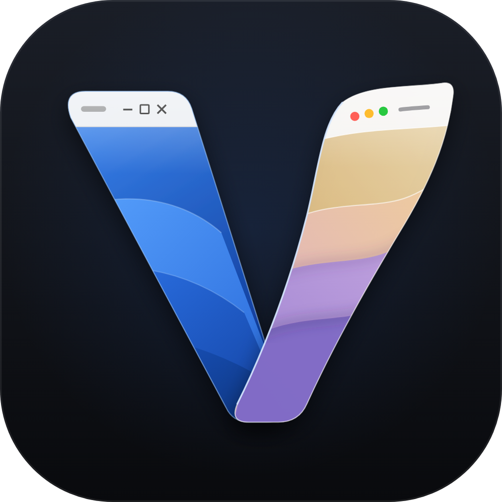
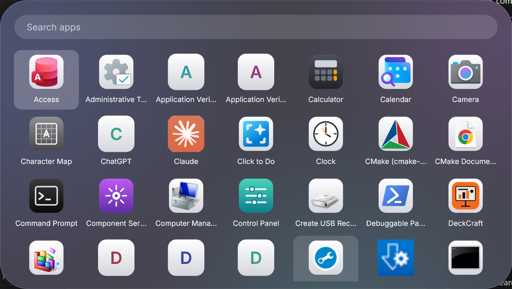
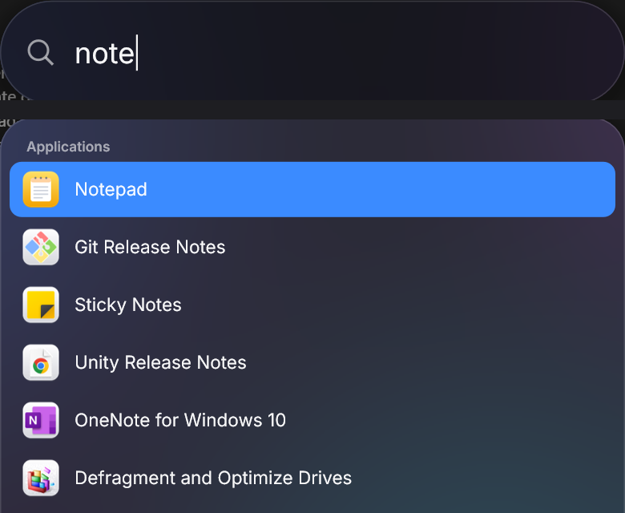
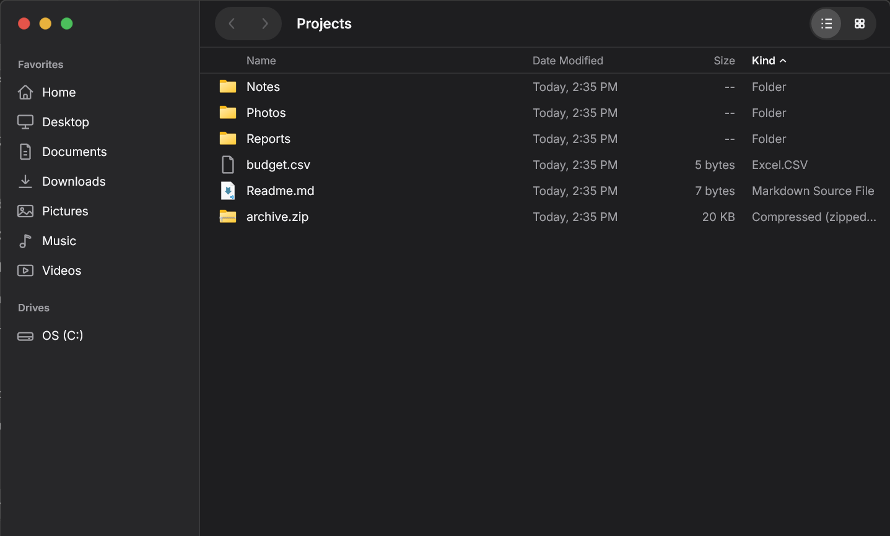
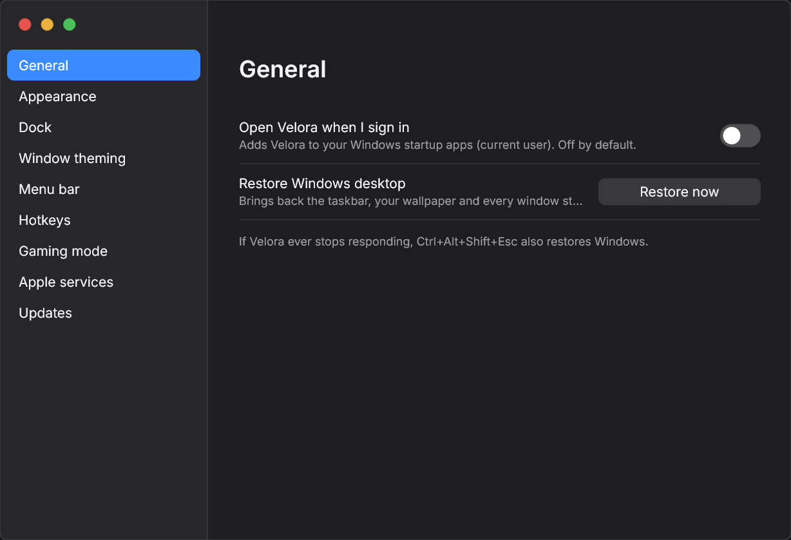
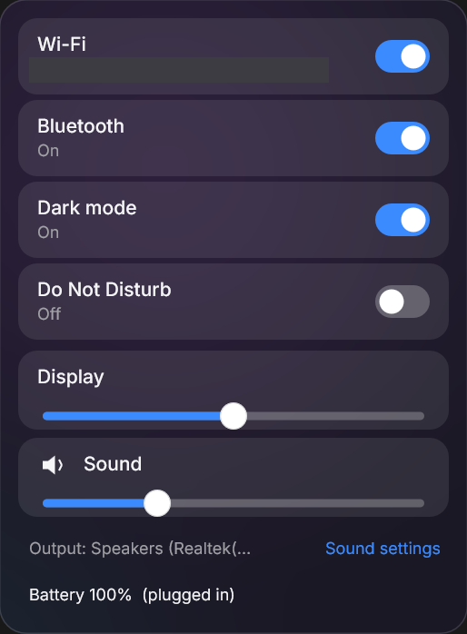

<p align="center"></p>

# Velora

*A veil over Windows, where two desktops meet.*

Velora is a free, open-source (Apache-2.0) **blend of Windows and macOS** for Windows 11: a Dock, a global menu bar, an app launcher, a file manager, search, a window overview, a Control Center and a Settings app, plus window theming through Windows' own documented APIs. No VM, no reboot, no kernel changes, no administrator rights. Windows keeps running underneath, your apps are never touched, and exiting Velora returns you to the normal Windows desktop instantly.

**Status:** pre-release, in development. **Velora v1.0 is Level 1**: a blend of Windows and macOS, not a full transformation (see the [roadmap](#roadmap)). Read [docs/PROGRESS.md](docs/PROGRESS.md) and [docs/VALIDATION.md](docs/VALIDATION.md) for exactly what is tested and what is not.

## What you get (Level 1)

| | |
|---|---|
| **Dock** | pinned and running apps, indicators, magnification, minimise/restore, Velora and Files icons |
| **Menu bar** | active app, global app menus (classic Win32 and UI Automation apps), clock, battery, Control Center |
| **Apps** | launcher grid of every installed app (Win32, Store, game shortcuts), search |
| **Files** | Finder-style file manager: sidebar, list/icon views, drag and drop, clipboard, Recycle Bin only |
| **Search** | Spotlight-style panel: apps and files from the Windows Search index, hotkey |
| **Overview** | live thumbnails of every open window, hotkey and optional hot corner |
| **Control Center** | volume, output device, Wi-Fi, Bluetooth, brightness, dark mode, Do Not Disturb, battery |
| **Window theming** | rounded corners, dark/light caption, neutral border, Mica/Acrylic on other apps' windows (DWM attributes, nothing injected), per-app exclusions |
| **Settings** | one place for all of the above; changes apply live |
| **Gaming mode** | automatic when a fullscreen/borderless game is in front: animations, blur and background work off, bars hidden; the game is never touched |
| **Apple services** (off by default) | launch or get Apple Music, Apple TV, Apple Devices, iCloud, iTunes; iCloud folders in Files; Velora never handles Apple credentials |

### Screenshots

Captured from the real Velora Mode on a Windows 11 laptop (1280x720 at 150 %, dark mode), cropped to Velora's own pixels. Nothing here is a mock-up.

| | |
|---|---|
|  |  |
|  |  |
|  |  |
|  |  |

## Safety first

- **Nothing is replaced.** Explorer keeps running; the taskbar is hidden, not removed. No registry shell swap, no system files changed, no security feature disabled.
- **No injection.** Velora never injects code into, subclasses or reparents another program's windows. Window theming uses `DwmSetWindowAttribute` from Velora's own process.
- **Full restore, several ways.** Exit from the menu; `velora-watchdog.exe --restore` (Start-menu shortcut "Restore Windows Desktop"); **Ctrl+Alt+Shift+Esc** even if the shell is frozen; and a watchdog that restores Windows within about a second if the shell crashes or hangs. Window styles, wallpaper and the taskbar are put back each time.
- **Your files are safe.** Deleting goes to the Recycle Bin; nothing is deleted for good without an explicit confirmation. Operations use the Windows shell's own file operations.
- **Private.** No telemetry, no accounts. Apple services never ask for, read or store Apple Account data.

## Install

Download from the [Releases](https://github.com/moelsaka01/velora/releases) page: `Velora-<version>-setup.exe` (per user, no admin), `Velora-<version>.msi` (per user), or the portable zip. Check the SHA-256 in `SHA256SUMS.txt`:

```powershell
Get-FileHash .\Velora-1.0.0-setup.exe -Algorithm SHA256
```

Release files are **unsigned** until the free open-source code-signing application is approved ([docs/SIGNING.md](docs/SIGNING.md)); new unsigned programs that hide the taskbar can be flagged by antivirus reputation systems. If yours blocks Velora, please report it to the vendor and to us, rather than disabling protection.

Start **Velora** from the Start menu; leave it from the Velora menu (the logo at the top left). If anything ever looks wrong, run **Restore Windows Desktop** from the Start menu.

## Build

Windows 11, Visual Studio 2022 Build Tools (C++), CMake 3.25+:

```powershell
cmake -S . -B build -A x64
cmake --build build --config Release
ctest --test-dir build -C Release -E "switch_gate|release_hooks"   # the two excluded tests launch the shell: run them on a test machine
```

Packaging (Inno Setup 6 and the WiX CLI) is done by `.github/workflows/release.yml`; `tools/package.ps1` stages the files.

## Limitations

See [docs/PARITY.md](docs/PARITY.md), [docs/MENU_COMPAT.md](docs/MENU_COMPAT.md) and [docs/THEMING_COMPAT.md](docs/THEMING_COMPAT.md). In short: a menu bar on every monitor and a Dock on the primary, every or the pointer's monitor (built and tested with simulated monitor sets, not yet verified on real multi-monitor hardware); some apps' menus cannot be read; elevated windows cannot be controlled from a normal shell; apps that draw their own frame may ignore title-bar theming; notifications (toast capture), virtual desktops and Cmd-style key remapping are not part of v1.0; output-device switching in Control Center opens Windows' Sound settings.

## Roadmap

- **Level 1 - v1.0:** a blend of Windows and macOS. Dock, menu bar, launcher, Files, Search, Overview, Control Center, Settings and window theming through documented Windows APIs. Nothing injected, nothing replaced, full restore.
- **Level 2 - v2.0 (late 2026 / early 2027):** the complete Windows-to-macOS transformation, including opt-in, per-app, reversible custom title bars, per-monitor bars, virtual-desktop integration and deeper window chrome.

Details in [ROADMAP.md](ROADMAP.md).

## License

Apache-2.0. See [LICENSE](LICENSE), [NOTICE](NOTICE) and [THIRD_PARTY_NOTICES.md](THIRD_PARTY_NOTICES.md). Velora uses no Apple or Microsoft proprietary code, icons, wallpapers or fonts; the UI font is Inter (SIL OFL).
